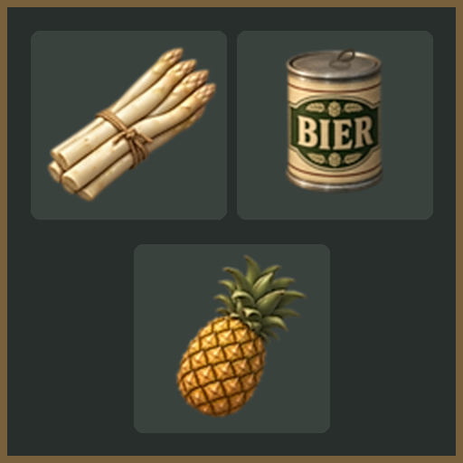

# Uboat-Smutje

Mod für UBOAT (Deep Water Studio), der die Lebensmittel in der Kombüse auf eigene Art zeigt.

## Phase 1: neue Symbole (Stand 0.1.0)

| Lebensmittel im Spiel | interner Name | neues Symbol |
|---|---|---|
| Gemüse | `Vegetables` | Bund weißer Spargel |
| Dosenbrot | `Canned Bread` | Bierdose |
| Exotische Früchte | `Exotic Fruits` | Ananas |

Die Bilder in `icons/` stellt der Nutzer bereit (PNG, 102 x 98 px, transparenter Hintergrund, Dateiname =
interner Name). `tools/draw_icons.py` enthält nur die ersten gezeichneten Entwürfe.



## Installation (ohne Workshop)

1. Den Ordner `mod/Uboat-Smutje` kopieren nach
   `%USERPROFILE%\AppData\LocalLow\Deep Water Studio\UBOAT\Mods\Uboat-Smutje`.
2. Im UBOAT-Launcher den Mod aktivieren.

Andere Mods, die dieselben Symbole ersetzen (z. B. „Authentic Goods“ oder „Pervitin“), überschreiben sich
gegenseitig. Welcher gewinnt, hängt von der Ladereihenfolge im Launcher ab.

## Phase 2 (geplant)

Bestimmte Lebensmittelkombinationen sollen Boni geben, z. B.
Exotische Früchte + Frisches Brot + Käse + Konserviertes Schweinefleisch = Toast Hawaii = Stimmung +3.
Siehe [docs/PHASE2.md](docs/PHASE2.md).

## Bauen und prüfen

Voraussetzung: Python 3 und `pip install -r requirements.txt`.

Ein Bild austauschen: die Datei in `icons/` ersetzen. Die Lage im Feld (z. B. damit die Mengenzahl oben
rechts nichts verdeckt) steht in `icons/verschiebung.json` als `[x, y]` in Pixeln; negativ heißt nach
links bzw. oben. Die PNGs selbst bleiben unverändert. Danach

```bash
python tools/build_bundle.py <gerüst-bundle> icons mod/Uboat-Smutje/Bundles/uboat-smutje
python tools/make_preview.py
python tests/test_bundle.py
```

Das Gerüst-Bundle ist ein vorhandenes UBOAT-Symbol-Bundle, das die drei Symbole enthält (z. B. der Ordner
`Bundles` des Workshop-Mods 2904931827). Es wird nicht ins Repository übernommen; im fertigen Bundle bleiben
nur technische Objekte und unsere Bilder. Warum das so gebaut wird: [docs/TECHNIK.md](docs/TECHNIK.md).

## Lizenz

MIT, siehe [LICENSE](LICENSE).
